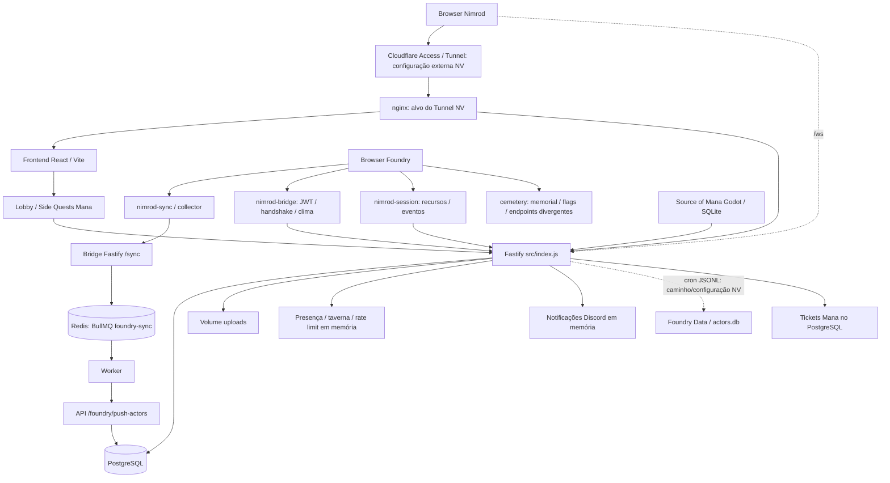

# Auditoria técnica do Nimrod

**Data:** 14/10/2026, referência de calendário America/Sao_Paulo.  
**Escopo:** checkout local `C:\Foundry\nimrod`, incluindo alterações ainda não commitadas. HEAD observado: `55efd00`.  
**Entrega:** diagnóstico e planejamento; implementação, contratos e esquema não foram alterados.

## 1. Diagnóstico executivo

Perfil e Personagens não podem ser considerados operacionais de ponta a ponta neste checkout. Existem defeitos de autorização, risco de apagar vínculos e histórico pela interface, divergências de identificadores e sincronização incompleta. Além disso, a aplicação principal depende de um arquivo ausente, impedindo seu carregamento sem uma configuração adicional.

Prioridades imediatas:

1. Impedir edição de personagens de terceiros, apropriação sem prova de elegibilidade e sobrescrita de vínculos em concorrência.
2. Impedir que a ação administrativa de desvincular apague o personagem e seus registros dependentes.
3. Corrigir autenticação de desenvolvimento em ambientes não locais, expiração dos JWTs e divulgação de notas privadas por WebSocket.
4. Tornar reproduzível o carregamento da aplicação principal e, depois, corrigir os contratos da sincronização.

**Resultados de execução:** 196 testes existentes passaram; 16 sondagens de auditoria reproduziram os comportamentos descritos abaixo; build do frontend passou. O import isolado de `tavernRoom.js` falhou com `ENOENT` para `tavernCollision.json`. Nada disso comprova funcionamento em produção ou integração real com Foundry, Redis ou PostgreSQL.

## 2. Método, evidências e limites

### 2.1 O que foi examinado

- Entradas do backend, 16 arquivos de rotas, serviços, middlewares, jobs, WebSocket e migrações SQL.
- Rotas React, contextos, chamadas HTTP, componentes de Perfil/Personagens e páginas dos demais módulos.
- Foundry Bridge, worker BullMQ, Redis, quatro módulos próprios do Foundry e seus manifestos.
- Dockerfiles, Compose principal local, Compose alternativo da Bridge, overlays Mana, configurações nginx e Vite.
- As dez suítes do backend, scripts de verificação de Mana e artefatos históricos de cobertura.
- Experimentos da taverna React/TypeScript e Source of Mana/Godot, distinguindo-os da aplicação principal.

Nenhum `AGENTS.md` foi encontrado no caminho do projeto ou nas subpastas examinadas. Havia mudanças locais e arquivos não rastreados antes da auditoria; foram preservados. O Compose principal existe localmente, mas está ignorado pelo Git. O README não é uma fonte confiável do estado operacional atual.

### 2.2 Convenções

| Evidência | Significado |
|---|---|
| E | Análise estática: arquivo, função e fluxo efetivamente encontrados. Não comprova integração em execução. |
| X | Execução isolada do código, com dados fictícios; quando indicado, banco, contexto Foundry ou transporte foram simulados. |
| NV | Integração/configuração não verificada. Ausência de teste não significa ausência da funcionalidade. |

Estados usados no inventário:

- **Confirmado funcional:** somente o comportamento delimitado que passou em execução. Não se estende automaticamente a banco, interface ou integração.
- **Confirmado defeituoso:** defeito reproduzido ou contradição determinística no código/contrato. A coluna de evidência identifica qual dos dois casos.
- **Não implementado:** capacidade específica ausente nos caminhos examinados; não se usa esse estado apenas por faltar teste.
- **Não verificado:** há implementação, mas faltam evidências suficientes de execução do fluxo.

Severidades: **Crítica** para risco de comprometimento amplo condicionado à exposição/configuração; **Alta** para quebra de autorização, perda de dados, indisponibilidade ou exposição sensível; **Média** para inconsistência funcional ou de recuperação; **Baixa** para problemas de manutenção/operação sem impacto imediato demonstrado. A severidade não implica que o problema já tenha sido explorado.

### 2.3 Proteção dos ambientes

Não foram lidos os valores do `.env`, consultados dados pessoais reais, iniciados servidores da aplicação, executadas migrações, instaladas dependências, iniciados containers ou feitas chamadas contra produção. Não houve consultas a bancos ou serviços existentes.

Os testes usaram configuração temporária com `setupFiles: []`, para impedir que `backend/tests/setup.js:4` carregasse o `.env` da raiz. Um preload bloqueou `net.Socket.connect` e `fetch`, com valores de conexão e credenciais exclusivamente fictícios. As sondagens substituíram dependências de persistência e os transportes que precisavam simular. O build usou `envDir: false` e saída de cache própria.

Scripts/configurações/resultados temporários ficaram em `node_modules/.cache/nimrod-audit` (ignorado pelo Git) e no diretório temporário do sistema. Não são testes adicionados à implementação nem uma suíte mantida pelo projeto. O único arquivo novo entregável é este relatório. Não foi modificado o arquivo histórico de cobertura.

**Limites explícitos:** esquema realmente instalado, sequência aplicada em `_migrations`, volumes, políticas Cloudflare Access, firewall, versões de Foundry/dnd5e/FXMaster, settings de mundos, consumidores externos das APIs e comportamento de navegadores reais permanecem NV. O relatório não afirma vulnerabilidades de versões de bibliotecas: não houve consulta a advisory nem análise de cadeia de fornecimento externa.

## 3. Arquitetura encontrada

O diagrama representa dependências encontradas no código, não topologia comprovada em execução.

### 3.1 Frontend

`frontend/src/main.jsx:9` monta React com `StrictMode`, `BrowserRouter`, `AuthProvider` e `WsProvider`. `App.jsx:226` registra Home, Lobby, Missões, Side Quests, Cemitério, Mapas, Perfil próprio/de terceiros, Patch Notes, Sessões e Calendário. `Layout.jsx` fornece navegação e elementos comuns.

`lib/api.js:1` fixa `/api`; não implementa sessão própria nem armazena token de autenticação. `AuthContext.jsx:35` recupera `/me`; uma falha torna `user = null`. Autenticação depende da sessão do proxy. As condições de interface não substituem autorização no backend.

Perfil usa `ProfilePage`, `CharacterCard`, `LinkCharacterModal` e upload direto de avatar; consulta `/players/:userId/profile`, `/me/characters/available` e rotas administrativas. Missões e posts também consomem a identidade dos personagens. Lobby abre o cliente Mana por ticket. O experimento TypeScript da taverna é uma aplicação separada; não é o `LobbyPage` do frontend principal.

### 3.2 Backend e ciclo de vida

`backend/package.json` e `backend/Dockerfile:14` usam **`src/index.js`**. Essa entrada registra CORS, WebSocket, multipart/static, autenticação, todas as rotas e executa migrações antes de iniciar os jobs e escutar em `0.0.0.0:3001` (`index.js:187–189`). Há efeitos colaterais durante import/startup, por isso a entrada não foi executada.

Há outra aplicação em **`src/app.js:52`**, usada pelos testes de launch/verify e por `src/server.js`. Ela tem autenticação simplificada, apenas parte das rotas e emissão de JWT diferente. `server.js` usa localhost:3000 e não é a entrada dos scripts normais. São aplicações diferentes; passar testes de `build()` não valida `index.js`.

`db/index.js:10` fornece um único pool `pg` e helper `query`. Predomina SQL direto em handlers; não há ORM ou repositório central de personagens. Existem transações dedicadas em calendários, atividades, mapeamento inicial Foundry e tickets Mana; vinculação de personagens e várias operações do feed/missões usam queries independentes.

### 3.3 Persistência e tarefas

- PostgreSQL é a persistência de negócio. `runMigrations()` enumera arquivos SQL por nome e registra `_migrations.filename` (`db/index.js:19`). A API aplica migrações no startup.
- Redis serve à Bridge/BullMQ, **não** ao pool de negócio, ao rate limit ou ao broadcast do backend.
- `ws/broadcast.js` mantém sockets por usuário em `Map` e transmite eventos para todas as conexões registradas. Não há distribuição entre réplicas, assinatura por sala ou filtro por role nesse helper.
- Rate limit (`middleware/rateLimit.js`) e fila Discord (`services/notifier/queue.js`) são locais ao processo.
- Jobs: sync JSONL a cada cinco minutos; decay do cemitério às 03h sem timezone explícito; tick de atividades via intervalo configurável. Não há eleição de líder demonstrada para múltiplas réplicas.
- Arquivos enviados são persistidos em `uploads`; substituição/exclusão de registros não faz uma política completa de retenção de arquivos.

### 3.4 Bridge, módulos Foundry e deployment

| Componente | Responsabilidade / dependências encontradas | Evidência / limite |
|---|---|---|
| Bridge Node | Fastify 5, CORS, Zod, Bull Board; `/sync` e `/sync/full` enfileiram em BullMQ | `foundry-bridge/index.js:31,51,76,99`; não iniciado |
| Worker Bridge | Consome `foundry-sync`, concurrency 2, limite 10 jobs/s; envia `{ actors }` com chave de API | `src/worker.js:31`; retries definidos no produtor, sem timeout de fetch |
| Redis | Redis 7, volume `/data`, snapshot `--save 60 1`; sem senha explicitamente passada pelos Compose examinados | Compose principal `109`; alcance da rede NV |
| nimrod-sync | Serializa personagens com `hasPlayerOwner`, debounce 2s, atualização periódica 10min | `nimrod-sync.js:4,51,122`; sem restrição a um GM/remetente único |
| nimrod-bridge | Consome JWT; abre ficha por nome; handshake/polling/status/clima opcional via FXMaster | `nimrod-bridge.js:155,576`; não autentica login Foundry nem concede ownership |
| nimrod-session | Detecta recursos e eventos estruturais, presença/heartbeat; envia com chave de API e retry | `scripts/main.js`, `EventDetector.js`, `PlayerHandlers.js`, `SceneHandlers.js`, `SessionSync.js` |
| cemetery | Memorial em settings/flags Foundry, morte/restauração, marca flags `nimrod-sync`; cliente HTTP separado | `MemorialData.js:144`; endpoints HTTP não correspondem ao backend local |
| Compose principal | DB, backend, frontend, Tunnel, Bridge/worker/Redis, nginx; volumes PostgreSQL/uploads/Redis | `docker-compose.yml`, ignorado pelo Git; NODE_ENV development; nenhum mount de Foundry Data |
| nginx principal | `/api/` remove prefixo; `/ws`, `/bridge/`, `/nimrod/`, `/foundry/`; destino Foundry no host | `nginx/nginx.conf:20,30,46,61,77`; política Access externa NV |
| nginx frontend | Serve SPA, API e uploads; não tem `/bridge/` ou `/nimrod/` próprios | `frontend/nginx.conf`; alvo efetivo do Tunnel deve ser verificado |
| Compose Bridge alternativo | Redis e Bridge/worker, portas apenas localhost | `docker-compose-bridge.yml:6,22` aponta build inexistente neste checkout |
| Mana | Serviço Godot/cliente web separado, persistência SQLite, autenticação dedicada por tickets e segredo servidor | `experiments/source-of-mana`, Compose e overlays; não executado |

`cloudflared` usa `network_mode: host`, apesar de comentário dizer que compartilha a rede dos containers (`docker-compose.yml:63,72`). Não se pode concluir qual origin está funcionando sem configuração externa. A porta de frontend e nginx está publicada em localhost; backend/Redis não têm publicação explícita no Compose principal. Isso não comprova a barreira de autenticação.

Manifestos declaram compatibilidade Foundry 13–14 para sync/session/cemetery e mínimo 11 para bridge. A Bridge exige `nimrod-session`, cujo mínimo é 13; portanto a instalação completa não tem compatibilidade de v11 demonstrada. dnd5e e FXMaster exigem validação no mundo isolado; campos e assinaturas de hooks não foram presumidos válidos só pelos manifestos.

## 4. Banco: tabelas e uso real no código

“Usada” abaixo significa leitura/escrita alcançável a partir das entradas encontradas, não tabela observada em um banco conectado.

| Tabelas / objetos | Consumidores encontrados |
|---|---|
| `users` | auth, usuários, todas as relações de autoria/propriedade, resolução de identidade |
| `posts`, `post_likes` | feed, respostas, curtidas, posts ligados a entidade/personagem |
| `missions`, `mission_participants`, `mission_ratings`, `mission_reactions` | missões, vagas/reservas, convites, avaliação, launch e sessões |
| `polls`, `poll_options`, `poll_votes` | mural e enquetes de missões |
| `characters`, `character_tributes` | memorial independente de personagens sincronizados |
| `player_characters`, `player_character_tributes` | Perfil, sync, memorial sincronizado, posts, missões, arcos, sessões, taverna, atividades, Mana |
| `maps` | upload/listagem de mapas |
| `user_foundry_map` | launch: email/role/mundo/nome; fallback de identidade/presença; administração |
| `patch_notes` | publicação e edição de notas |
| `session_logs`, `resource_deltas`, `session_snapshots` | cabeçalhos, deltas e consolidação de sessões |
| `resource_delta_audit` | trigger de auditoria de edição/exclusão lógica; leitura/escrita da aplicação depende do fluxo SQL |
| `v_session_player_totals`, `v_session_event_feed` | views definidas na migração 019; sem consumidor encontrado em backend/src. As rotas de sessões consultam tabelas/aggregações próprias. Preservar até verificar consumidores externos. |
| `mission_arcs`, `arc_participants` | arcos, participantes, fechamento/recompensas e timeline |
| `session_attendance`, `foundry_handshakes`, `session_events` | presença, handshake e eventos estruturais |
| `world_calendar`, `world_calendar_audit`, `season_effects` | calendário/estações e histórico/efeitos |
| `activities`, `activity_participants`, `activity_logs` | Side Quests, contribuição, relatório, auditoria; logs Mana também |
| `mana_launch_tickets` | emissão, consumo, reautorização e snapshots de identidade Mana |
| `_migrations` | criado/consultado pelo runner, fora dos arquivos SQL numerados |
| `foundry_actors` | **Sem leitor/escritor encontrado em `backend/src`**. Criado na migração 007; cache efetivo atual é `player_characters`. Não remover sem inventário externo. |
| `hashtags` | **Sem consumidor encontrado em `backend/src`**. Campo/enum/índice existente não prova funcionalidade. |

O vínculo principal é `player_characters.user_id → users.id`; `foundry_actor_id` tem unicidade global. Não há identidade composta por mundo/Actor. A tabela `user_foundry_map` usa email e nome de Actor, sem FK entre seu mapeamento e o vínculo UUID. `foundry_owner_ids` existe por migração, mas nenhum produtor/consumidor de autorização foi encontrado no backend/módulo sync atuais.

Há 35 arquivos SQL numerados até 033, com dois arquivos 007 e dois 008. O runner usa o nome completo, portanto a duplicação de números não é por si só uma colisão de tracking. A ordem lexicográfica, o conteúdo já aplicado e alterações históricas nesses arquivos precisam ser auditados antes de migrar uma base existente.

## 5. Inventário funcional e estados

| Funcionalidade | Componentes / rotas principais | Estado | Evidência e alcance |
|---|---|---|---|
| Compilação frontend | React/Vite, App e páginas alcançáveis | **Confirmado funcional** | X: build passou; sem teste de navegação ou integração |
| Assinatura/validação JWT fornecido com expiração | `services/foundryAuth.js` | **Confirmado funcional** | X: nove testes de criptografia/round-trip/expiração; não comprova segurança da emissão da rota real |
| Guardas básicos de list/link/unlink de Perfil | `profileRoutes`, `/me/characters*` | **Confirmado funcional** | X: dez testes reais de handlers com query mock; valida apenas as condições testadas |
| Leitura de perfil, criação manual, edição legítima | `/players/:userId/profile`, `/characters` | **Não verificado** | E: código encontrado; banco/interface completos não exercitados |
| Autorização de edição por proprietário | PATCH `/players/:userId/characters/:id` | **Confirmado defeituoso** | X P01: aceita personagem de outro usuário |
| Elegibilidade/atomicidade da autovinculação | `/me/characters/available`, POST/DELETE link | **Confirmado defeituoso** | X P02/P03; não há prova Foundry nem atualização condicional |
| Gerenciar todos / desvincular pelo GM | `LinkCharacterModal`, `/all-characters`, DELETE personagem | **Confirmado defeituoso** | X P05/P06 + E: ID Actor diferente de UUID e DELETE real |
| Painel de todos os jogadores | `AllPlayersPanel`, GET `/players` | **Confirmado defeituoso** | E: SELECT usa colunas ausentes no esquema versionado (A07); execução SQL NV |
| Avatar próprio | PATCH/POST `/me/avatar`, `AvatarUpload` | **Não verificado** | E: duas implementações com limites diferentes; conteúdo e persistência não exercitados |
| Contagem de missões por personagem | `getMissionCounts`, GET profile | **Confirmado defeituoso** | E: atribui total do usuário a todos os personagens, apesar de FK específica existir |
| Importação JSONL de Actors | `readFoundryActorsDb`, sync manual/cron | **Não verificado** | E: caminho/mundo/mount/arquivo reais NV; não há leitor LevelDB implementado nesse serviço |
| Ordenação e preservação de estado no sync | `normalizeFoundryActor`, `upsertFoundryActors` | **Confirmado defeituoso** | X P07–P09 + E: versões/flags/snapshot divergem |
| Atributos Foundry → Bridge → banco | collector/ActorSchema/upsert | **Confirmado defeituoso** | X P14: schema descarta `abilities`; backend passa a valores default |
| Reconciliação de exclusões pela Bridge | `/sync/full`, worker, push | **Não implementado** | E: `fullSync` não chega ao backend; não há deleteActor no sync; não equivalente à inativação pelo cron |
| Recuperação do collector após desconexão | `SyncCollector.flush` | **Confirmado defeituoso** | X P13: rebuffer sem novo timer; reload perde buffer |
| Chave dedicada no push/eventos | `isFoundryRequest`, rotas Foundry | **Não verificado** | E: validação existente; alcance e sigilo da chave no Foundry NV |
| Autenticação humana Cloudflare | `cfAuthMiddleware`, nginx/Tunnel | **Não verificado** | E: confia em header; políticas e origin externo NV |
| Isolamento de DEV_USER_EMAIL | `cfAuthMiddleware` | **Confirmado defeituoso** | X P12: funciona com NODE_ENV production |
| Launch real com JWT temporário | `foundryRoutes` GET launch | **Confirmado defeituoso** | X P04: JWT não contém `exp` |
| Login/ownership Foundry por JWT | `consumeLaunchToken`, `openMappedActor` | **Não implementado** | E: verificação abre ficha por nome; não seleciona login, altera permissões nem muda mundo |
| Handshake/ativação de sessão | `/nimrod/handshake*`, link-foundry | **Não verificado** | E: fluxos presentes, mas TTL, concorrência e contrato de campanha divergem |
| Presença e eventos por personagem | `actorResolution`, presence, session-events | **Confirmado defeituoso** | X P10/P11 + E: validação inconsistente e fallback por nome |
| Sessões/deltas/consolidação | SessionsPage, sessions.js, SQL 019 | **Não verificado** | E: implementação presente; 80 testes usam cópia das rotas |
| Confidencialidade de notas de sessão | SESSION_CREATED/CLOSED, broadcast | **Confirmado defeituoso** | X P16 + E: payload contém gmNotes e helper transmite a todos |
| Posts, respostas, likes, entidade/personagem | Home/PostCard, posts.js | **Não verificado** | E: rotas e SQL presentes; sem suíte de fluxo real encontrada |
| Missões/vagas/convites/avaliações | MissionsPage, missions.js | **Não verificado** | E: implementação presente; concorrência e integridade de personagem pendentes |
| Enquetes/prazo/votos | polls.js e missões | **Não verificado** | E: persistência presente; prazo e contadores têm defeitos específicos A25 |
| Arcos e recompensas de sessões | arcs.js + sessões | **Não verificado** | E: implementação presente; sem suíte própria encontrada |
| Memorial web e tributos | CemeteryPage, cemetery.js | **Não verificado** | E: dois modelos de memorial; sem execução real |
| Decay de tributos | `startCemeteryDecay` | **Confirmado defeituoso** | X P15: callback gera ReferenceError |
| Cemetery HTTP → Nimrod local | NimrodSync markDead/markRestored | **Confirmado defeituoso** | E: rotas chamadas ausentes; flags locais podem sincronizar por outro caminho |
| Mapas e downloads | MapsPage, maps.js, static uploads | **Não verificado** | E: rotas presentes; política de tipos/arquivos pendente |
| Patch Notes | PatchNotesPage, patchNotes.js | **Não verificado** | E: implementação presente; sem execução end-to-end |
| Calendário/efeitos/clima | CalendarPage, serviços, FXMaster bridge | **Não verificado** | E: transações/guards presentes; Foundry/FXMaster NV |
| Side Quests: handlers testados | ActivityEngine, sideQuests.js | **Confirmado funcional** | X: 20 testes com SQL mock; não comprova efeitos no banco ou tick |
| Autoencerramento Side Quest comum | TickEngine | **Confirmado defeituoso** | E: import dinâmico aponta para arquivo inexistente; rollback no catch |
| Arena/Research/Rest/Hospital | enums / resolver registry | **Não implementado** | E: único resolver registrado é SIDE_QUEST; enum/RFC não implementam esses fluxos |
| Aplicação/coleta de recompensas em ficha | `reward_data`, RewardFormulaRegistry | **Não implementado** | E: calcula/guarda recompensa; não foi encontrado claim/aplicação dessa recompensa no Actor |
| Tickets/guards Mana testados | ManaAccess e mana routes | **Confirmado funcional** | X: 32 testes isolados; consume/revalidate/rollback em mocks |
| Lobby Mana/Godot/SQLite completo | LobbyPage, Source of Mana | **Não verificado** | E: scripts de integração existentes não executados |
| Taverna WebSocket da aplicação | tavernRoom e experimento | **Confirmado defeituoso** | X: import falha por JSON ausente; seleção do protótipo chama rota ausente |
| Conexão/reconexão WS frontend | WsProvider | **Não verificado** | E: backoff existe; ciclo StrictMode e close 1008 têm riscos concretos A27 |
| Notificações Discord | notifier/worker/queue/discord | **Não verificado** | E: consumo registrado por import; transporte engole falha, fila não é durável |

## 6. Fluxo de Perfil e sincronização de personagens

### 6.1 Identificação do usuário autenticado

1. Browser consulta `/api/me`; nginx deve remover `/api` antes de enviar à API.
2. O hook `index.js:122` delega ao `cfAuthMiddleware`, exceto rotas técnicas explicitamente isentas.
3. O middleware consulta/upserta `users` e atribui a linha de banco a `request.user`. A identidade usada por Perfil é `req.user.id`, não email enviado pelo browser.
4. `X-Dev-User` troca usuário no modo não production; `DEV_USER_EMAIL` força usuário/role **sem** esse bloqueio. Na ausência de bypass, usa header Cloudflare sem validar JWT Access no backend.
5. `AuthContext` conserva o usuário retornado; `App` sincroniza ROLE_UPDATED via refresh. O próprio middleware pode atualizar `users.name` em requisições, enquanto outros caminhos usam `display_name` como identificador heurístico.

### 6.2 Recuperação dos personagens

- `/me/characters` retorna personagens ligados ao usuário, ativos e não aposentados, mas não filtra `dead` (`profile.js:110`).
- `/me/characters/available` lista personagens ativos/vivos/não aposentados que estejam sem dono **ou** já ligados ao usuário (`121`). Não filtra ownership Foundry.
- `/players/:userId/profile` retorna usuário, todos os seus personagens e estatísticas. É protegido pelo hook humano, apesar de comentário chamar o perfil de “public”.
- `/foundry/actors/unlinked` é GM e retorna DTO Nimrod com UUID de `player_characters` (`412`).
- `/foundry/actors` e `/foundry/actors/all-characters` retornam DTO Foundry com Actor ID, sem userId. A origem pode ser JSONL ou cache SQL, mudando campos, mas não corrigindo a incompatibilidade com a interface de gerenciamento.

### 6.3 Associação e persistência

- Self-link: lê personagem por UUID; rejeita morto/aposentado/dono diferente; depois atualiza `user_id` por `id` incondicionalmente. Não confirma active, ownership Foundry ou prova de identidade Foundry. Dois clientes podem passar a leitura inicial e ambos receber sucesso.
- Self-unlink: confirma dono na leitura; atualiza `user_id = NULL` por id. Não revalida dono no UPDATE, portanto pode apagar transferência concorrente feita por GM.
- GM link: PATCH `/players/:userId/characters/:charId/link` muda `user_id`; aceita transferência, sem validar active/dead/retired ou consistência do userId de origem.
- PATCH genérico permite biografia/retrato para suposto owner ou admin, mas owner é calculado pela URL, não pela linha retornada. Admin também muda estado e vínculo.
- DELETE administrativo remove `player_characters`; não é uma desvinculação. O modal chama esse DELETE com texto de desvincular.
- `user_foundry_map` é independente: self-link/GM-link não atualizam o nome/Actor usado no launch. Não existe uma associação comprovada `users.id ↔ Foundry User.id`. Nomes não substituem essa relação.

### 6.4 Atualização dos dados

**Caminho push:** eventos Foundry → `serializeActor` → Map em memória → `/bridge/sync` → Zod → BullMQ/Redis → worker → `/foundry/push-actors` → `upsertFoundryActors` → PostgreSQL.

**Caminho pull:** cron/manual → `actorDbPath` → leitura JSONL de `Data/worlds/<world>/packs/actors.db` → normalização → mesmo upsert. Sem mundo configurado, escolhe primeiro arquivo encontrado; sem caminho/arquivo, retorna `ok:false`. Não há leitura LevelDB ou descoberta verificada do armazenamento da instalação Foundry.

O upsert preserva `user_id`, mas sobrescreve nome, nível, XP, classe, raça, biografia, imagens, dead, retired, active e atributos. Não há política explícita de precedência entre edição Nimrod e dados Foundry. Reaposentações/biografias editadas no Nimrod podem ser desfeitas no push seguinte.

`modifiedAt` produzido pelo collector não é consumido pela normalização. O guard SQL compara versão da origem com horário local de recepção (`last_synced_at`), misturando conceitos. Mesmo a primeira normalização de JSONL pode perder a versão ao ser normalizada novamente. Não há versão monotônica persistida de snapshot/Actor.

Push não transmite remoções nem emite evento WebSocket de atualização. O cron emite FOUNDRY_ACTORS_SYNCED, mas Perfil escuta apenas CHARACTER_UPDATED/AVATAR_UPDATED. O botão manual aceita qualquer resposta HTTP 200 como sucesso, inclusive `{ok:false}`.

### 6.5 Erros, desconexões e inconsistências

- Collector rebufferiza falhas, mas não agenda retry próprio; depende de novo evento/sync periódico. Buffer é volátil e falha antiga pode sobrescrever atualização mais nova enquanto o request está em voo.
- Bridge confirma enfileiramento, não persistência. Há cinco tentativas com backoff; jobs falhos ficam na fila, mas o browser não acompanha seu resultado. O worker não tem timeout de fetch.
- `fullSync` é produzido, mas ignorado pelo worker; snapshot vazio é rejeitado na Bridge/push. No pull, array vazio sai antes de inativar qualquer registro. Ausência de snapshot e snapshot vazio não são distinguidos de forma segura.
- Upserts são executados individualmente, sem transação de lote: erro intermediário pode deixar atualização parcial. Não há source/world em cada item que delimite reconciliação.
- Leituras ignoram linhas JSONL malformadas e ainda consideram a fonte disponível; marcar ausentes como inativos após leitura parcial pode esconder personagens válidos.
- Erro do cron de sync só é registrado fora de production. Handler global expõe `error.message` ao cliente; erros internos de DB/caminhos não têm redação dedicada.
- `actorResolution` procura `foundry_actor_id` global; há tier por nome/email map/display_name com LIMIT 1 sem unicidade. Personagem sem dono pode resolver parcialmente; characterId fornecido junto ao actorId pode ser aceito sem corresponder ao Actor.
- `registerSessionPresence` permite `characterId` do body sobrepor claim do JWT sem validar dono; session-events mantém IDs fornecidos mesmo quando a resolução falha. A API key é ampla e não associa o remetente a um mundo/sessão específica.

## 7. Problemas classificados e testes de correção

### 7.1 Segurança e preservação dos vínculos

| ID / severidade | Evidência: arquivo, função, linha | Comportamento e risco | Testes necessários |
|---|---|---|---|
| **A01 Alta** — edição de terceiro | `routes/profile.js`, PATCH handler `333–372` | **X P01**: usuário usa o próprio userId na URL e UUID alheio; 200 e UPDATE só por id. Permite alterar biografia/retrato alheios. | Rota real: próprio/terceiro, URL adulterada, role PLAYER/GM/GM_PRINCIPAL; nenhuma escrita/broadcast em rejeição; corrida com transferência. |
| **A02 Alta** — autovinculação sem prova | `profile.js`, available `121–139`, link `142–160`; migração 020 `11` | **X P02 + E**: aceita personagem inativo em chamada direta e ignora Foundry owners. Qualquer autenticado pode reclamar personagem sem dono; isso propaga identidade incorreta a sessões/Mana. | Mundo isolado com dois usuários e ownership diferente; falhar quando não há prova; aceitar somente candidato comprovadamente elegível. Não inferir autorização por nome. |
| **A03 Alta** — concorrência de vínculo | `profile.js`, link `144–160`, unlink `169–182`, GM link `384–389` | **X P03 + E**: duas leituras de sem-dono resultam em dois 200; última escrita vence. Unlink pode apagar reatribuição concorrente. | PostgreSQL descartável: duas conexões reais, um vencedor; unlink versus transferência; transações/UPDATE condicional, retorno idempotente definido. |
| **A04 Alta** — desvinculação apaga registro | `LinkCharacterModal.jsx`, `unlinkChar:60–69`; `profile.js`, DELETE `399–406` | **X P06 + E**: modal chama DELETE real. FKs podem zerar referências em posts/missões/presença, apagar tributos/participantes/tickets e perder UUID estável; demais FKs podem bloquear a operação. | Desvincular preserva personagem, UUID e todos os registros dependentes; nenhum DELETE; personagem volta à lista elegível; transferir preserva histórico. |
| **A05 Crítica condicional** — bypass humano | `middleware/auth.js`, `cfAuthMiddleware:43–94`; Compose `31`; `index.js:189` | **X P12 + E**: DEV_USER_EMAIL é aceito mesmo em production; modo development habilita X-Dev-User. Header Cloudflare sozinho é confiança de rede. Com origin acessível ou configuração dev implantada, ocorre impersonação e possível privilégio GM. Exposição efetiva NV. | Matriz NODE_ENV × variáveis dev × headers; em production ignorar/rejeitar bypass; requisição direta sem prova legítima não autentica; verificar política origin/Tunnel em ambiente isolado. |
| **A06 Alta** — JWT sem TTL / replay | `routes/foundry.js`, launch `182–195`; `services/foundryAuth.js:12`; `app.js:119` | **X P04**: rota real não passa exp nem expiresIn; token é reutilizável sem prazo. Test factory passa exp de cinco minutos, README fala prazo diferente. JWT na query contém identidade e pode aparecer em logs/histórico; módulo remove query após verify, não antes do request inicial. Não prova bypass de login Foundry. | Testar rota real, exp obrigatório, prazo documentado, token expirado/sem exp/payload incompatível; não registrar token; enter/leave revalidam contexto/propriedade. |
| **A07 Alta** — SQL do painel inválido | `profile.js`, GET players `212–230`; SQL 009 `18`, 010 `8` | **E**: usa `class`, `token_img_url`; esquema versionado usa `classe`, `token_img`. Contra esse esquema a query não funciona. `AllPlayersPanel:138` transforma erro em lista vazia. Banco instalado NV. | Executar migrações em base descartável e GET players com fixture; assert campos; UI distingue falha de ausência de jogadores. |
| **A08 Alta** — notas privadas no broadcast | `sessions.js`, serializeSession `55`, create `436`, close `594`; `ws/broadcast.js:29–35` | **X P16 + E**: SESSION_CREATED inclui gmNotes; helper transmite para todos os usuários, inclusive jogadores e GMs fora da sessão. Autorização HTTP não protege o canal WS. | Conexões de PLAYER, narrador, GM externo, principal; eventos de criação/fechamento nunca entregam notas a público indevido; testar dados recebidos, não só UI. |
| **A09 Alta** — chave ampla no cliente / entrada Bridge sem auth | `nimrod-bridge.js`, settings `78`, hdrs `117`; `nimrod-session/SessionSync.js:58–103`; Bridge `/sync:76`, `/sync/full:99`, Bull Board `44` | **E, alcance NV**: chave de integração fica em settings e é utilizada pelo browser; chave pode emitir dados para diversas sessões. Bridge/Bull Board não validam identidade e CORS reflete qualquer origem. Se `/bridge` estiver acessível, produtor pode usar worker como escrita autenticada. Loopback/publicação interna não substituem validação de origem/remetente. | Verificar leitura da setting com jogador real isolado; produtor não autorizado negado; limitar escopo mundo/sessão; acesso ao Bull Board restrito; nenhuma chave nos relatórios/logs. |
| **A10 Alta** — identidade inconsistente | `actorResolution.js`, `resolveEventIdentity:129–223`; `foundry.js`, presence `232–274`; `sessionEvents.js:187–255` | **X P10/P11 + E**: actorId aceita characterId diferente; characterId sozinho retorna null antes do tier documentado; em session-events IDs são mantidos quando resolução falha; presence JWT aceita characterId arbitrário. Fallback por nome é ambíguo e duplicado em presence `441–463`. | Casos actorId/characterId/playerId conflitantes, personagem sem dono/morto/inativo, nomes iguais, GM sem personagem; evento sem identidade mantém só dados brutos e nunca vínculo inválido. |

### 7.2 Sincronização, contratos, disponibilidade e manutenção

| ID / severidade | Evidência: arquivo, função, linha | Comportamento e risco | Testes necessários |
|---|---|---|---|
| **A11 Alta** — aplicação principal não carrega sem arquivo extra | `tavernRoom.js`, leitura no módulo `108–110`; `index.js:27`; overlay mana.local `5` | **X**: import isolado falhou ENOENT `tavernCollision.json`. Overlay monta arquivo, mas Compose principal/Dockerfile não o fornecem. Pode derrubar toda API antes de listen/migrações. | Import/build da entrada real com dependências substituídas e mapa válido; imagem principal sem overlay; mapa ausente gera comportamento deliberado verificável. |
| **A12 Alta** — IDs do gerenciamento incompatíveis | `foundry.js`, `listFoundryActors:50–94`; `LinkCharacterModal:44,64,76` | **X P05 + E**: all-characters retorna Actor ID, sem userId, tokenImg e campos próprios da lista; modal trata como UUID/DTO Nimrod. Personagens manuais são excluídos da lista. | Contrato UI/API com personagem manual/sincronizado, UUID distinto do Actor ID; listar, transferir e desvincular; testar ambos os caminhos de fonte/cache. |
| **A13 Alta** — atributos descartados pela Bridge | `collector.js`, serializeActor `79`; Bridge `ActorSchema:51–65`; `foundrySync.js:83–92` | **X P14**: Zod remove abilities desconhecido; worker manda objeto já filtrado; upsert converte ausência para dez. Distorce cálculos de Side Quests mesmo com atributos reais diferentes. | Fixture de seis atributos passa serializer/schema/fila/worker/upsert e mantém valores; campos ausentes não sobrescrevem snapshot válido por defaults silenciosos. |
| **A14 Alta** — ordenação e atualização destrutiva de estado | `foundrySync.js`, normalize `97–113`, upsert `169–187`; collector `80` | **X P07/P09 + E**: modifiedAt não é lido, data de recepção serve de versão; upsert reativa e sobrescreve aposentadoria/biografia/imagens editadas localmente. Também usa flags.nimrod em pull versus flags.nimrod-sync no collector/cemetery. | Eventos fora de ordem, replay, clock skew, dupla normalização, edição local, flags de morte/aposentadoria, ausência de campos; vínculo e história preservados. |
| **A15 Média** — full sync não reconcilia | `nimrod-sync.js`, syncAllActors `4–22`; Bridge `85,108`; worker `34,47`; upsert `146,212` | **X P08 + E**: fullSync perdido, módulo só chama /sync, snapshot vazio não reconcilia, sem deleteActor; cron pode inativar a partir de leitura parcial e não delimita mundo. | Snapshot completo/parcial/vazio/indisponível/corrompido, exclusão e perda de ownership; inativação apenas quando snapshot completo confiável; não excluir dados. |
| **A16 Média** — recuperação insuficiente | `collector.js`, flush `106–133`; worker `41–48`; sync cron `239–244` | **X P13 + E**: sem retry agendado após falha; buffer volátil; rebuffer antigo pode vencer atualização nova; fetch worker sem timeout; logs de falha omitidos em production. | Bridge offline/503, retorno, duas versões em voo, timeout/fila/stall, reload; observable resultado persistido e limite de tentativas. |
| **A17 Média** — Perfil desatualizado e falso sucesso | `ProfilePage:350–360,395–400`; sync `233`; push `663–666`; `CharacterCard.jsx:111–115` | **E**: push não emite update; Perfil não escuta FOUNDRY_ACTORS_SYNCED; triggerSync ignora ok:false; CharacterCard inicializa estado do prop sem sincronizá-lo em updates. | Push/cron/manual atualizam card e lista; ok:false/falha parcial apresentados como falha; troca de perfil e reconexão recuperam snapshot. |
| **A18 Média** — contagem incorreta | `profile.js`, GET profile `265–283`; SQL 020 `19` | **E**: missão de um personagem é contada para todos os personagens do usuário. `/me/characters` também não filtra mortos e mission join só exige active (`missions.js:516`); posts só exige não aposentado (`posts.js:123`). | Dois personagens com participações distintas, participação sem personagem, morto/aposentado/inativo nos seletores e nos POSTs diretos. |
| **A19 Média** — avatar duplicado e conteúdo não validado | `profile.js`, uploadAvatar `62–88`, POST `424–462`; `ProfilePage:32`; mapas `maps.js:37–50` | **E**: PATCH usado pela UI não aplica limite de 4 MB; POST usa bytesRead após gravar; global permite 50 MB; extensão é do cliente e MIME não é verificação de bytes. Uploads servidos sem auth. Há risco de armazenar/servir conteúdo ativo ou arquivos fora da política, não explorado nesta auditoria. | Arquivo >4 MB, MIME/assinatura/extensão divergentes, .html sob MIME imagem, truncamento, timeout, falha DB, limpeza de arquivo parcial; URL e cache seguros. |
| **A20 Alta** — decay não executa | `jobs/cemeteryDecay.js`, callback `11–18`; `routes/cemetery.js`, cleanExpiredTributes `324` | **X P15**: função não está no escopo nem importada; ReferenceError é capturado e nenhuma limpeza acontece. | Callback real com relógio fixo, tributo recente/vencido/zero, timezone deliberado, repetição sem decaimento duplicado. |
| **A21 Alta** — tick não encerra Side Quest comum | `jobs/tickEngine.js`, autoCloseExpired `81–129` | **E**: importa `./reportEngine.js` dentro de jobs, arquivo existe em services; rollback após erro. Caminho Mana FAILED não usa esse import. Mesmo corrigido, tick não calcula recompensas como finish manual. | Atividade comum expirada encerra e gera relatório/recompensas consistentes; caminho Mana; corrida tick/finish; rollback e repetição; testar arquivo real. |
| **A22 Média** — Cemetery HTTP sem contrato local | `cemetery/NimrodSync.js`, markDead `151–157`, markRestored `182–187`, ping `266`; inventário rotas | **E**: /actors/:id/status, /sync/death, /sync/restore e /ping ausentes no backend/Bridge locais; Bearer não é a chave esperada por esses caminhos. Flags Foundry podem atualizar o push independentemente. | Mundo isolado: registrar morte/restaurar, confirmar flags e estado Nimrod pelo caminho aprovado; falha remota não aparenta sync confirmado. |
| **A23 Média** — bootstrap e mapping divergentes | `foundryMap.js`, resolveFoundryMapping `38–66`; `profile.js` link; SQL 005 | **E**: primeiro usuário da tabela vazia ganha GM Foundry independentemente de users.role; world default main; nomes do mapping não acompanham link/rename. SERIALIZABLE existe, mas retry de serialization failure não. | PLAYER não ganha privilégio por ordem de acesso; setup administrativo explícito; concorrência PostgreSQL com dois emails; rename/link/launch consistentes sem reatribuição por nome. |
| **A24 Média** — handshake/campanha divergem e corrida | `foundry.js`, handshake `310–330`; `sessions.js`, link `271–295`; SQL 025 `19–26` | **E**: migração permite expires_at null, mas rota trata null como data passada; seleção de code ignora permanentes e ON CONFLICT pode resetar claim; link lê antes de UPDATE incondicional. | Handshake nulo/expirado/claimado, relink legítimo, duas sessões competindo pelo mesmo code, colisão; nenhuma sobrescrita de claim. |
| **A25 Média** — contadores/prazos concorrentes | `polls.js`, vote `103–141`; `missions.js`, join `525–542`; SQL 023 | **E**: voto não verifica closes_at; mudanças de voto/contador sem transação; contagem de vagas seguida de insert sem lock pode exceder capacidade. | Dois votos/joins paralelos em banco real, voto após fechamento, falha intermediária; invariantes de capacidade e contagem. |
| **A26 Média** — infraestrutura não reproduzível / migração | Compose alternativo `6,22`; `backend/package.json` script migrate; `db/index.js:32–53`; SQL 007 `21–31`, SQL 033 | **E**: caminho build alternativo inexistente; script migrate aponta para arquivo inexistente; aplicação e registro de migração não são atômicos. Algumas DDLs falham se reaplicadas (trigger/constraint sem guard). Startup paralelo sem lock/checksum. | Validar configuração sem interpolar segredos em logs; migração fresh/base existente/queda antes de tracking/reexecução/dois runners; snapshot e restore; imagem isolada. |
| **A27 Média** — WebSocket/permissões/estado local | `WsContext.jsx:14,28–54,62`; `main.jsx:9`; `index.js:90–121`; `broadcast.js` | **E**: cleanup define deadRef permanentemente; segundo setup StrictMode não o reinicia. Backend fecha 1008, frontend só para por mensagem ERROR que não recebe nesse caso. Socket conserva principal do handshake, sem revalidar mudança de role/sessão para toda ação; memória não distribui entre réplicas. | Montagem StrictMode, close 1008, expiração/alteração de role, reconnect/refetch, duas réplicas; não multiplicar retries nem manter permissões revogadas. |
| **A28 Média** — transportes/artefatos incompletos | `notifier/discord.js:18–35`, worker `19–25`; `rewardFormulas.js:38–48`; `activityEngine.js:460–504`; `lib/events.js:44–64` | **E**: Discord captura erro sem relançar, impossibilitando retry do worker; fila/auditoria emitida após commit podem perder eventos. winner_takes_all é placeholder que recompensa todos; rewards são metadados sem claim/aplicação. | 429/500/rede/restart; auditoria e efeito comprometidos juntos ou estado recuperável; winner correto ou estratégia não disponível; não anunciar recompensa aplicada. |
| **A29 Baixa** — código/README/testes divergentes | `app.js`, `server.js`, `tests/sessions.test.js:108`, `tests/userIdentity.test.js:17`; README | **E**: aplicações duplicadas, testes de cópias passam sem tocar a implementação; claims de prazo/login/consentimento não correspondem ao código. | Suítes importam rotas/serviços reais; falha intencional na lógica real faz teste falhar; registrar origem de cada evidência. |
| **A30 Média** — desenvolvimento/protótipo com endpoint errado | `frontend/vite.config.js:11–14`; `experiments/tavern/src/engine/nimrodApi.ts:27,97`; `useTavern.ts` | **E**: proxy Vite não remove /api enquanto backend recebe /me etc.; protótipo chama POST /api/characters/:id/select ausente. Build não detecta contrato HTTP ausente. | Navegação local via Vite e seleção no protótipo com rota real; nenhuma criação de API nova nesta etapa; identificar caminho operacional escolhido. |
| **A31 Média** — escopo multiworld/SQL parcial | SQL 009 `28`; `foundrySync.js:14–18,161–222`; `actorResolution.js:76` | **E**: Actor ID único global e sem world; cache e reconciliação podem misturar mundos. SQL de abilities depende da migração 031 ainda não rastreada; arquivo único corrompido pode provocar inativação indevida. | Dois mundos com mesmo Actor ID, fonte parcial e instalação anterior à 031; mapear dados sem fundir/excluir; rollback/replay conservam propriedade. |

Não foi observada interpolação direta de valores de usuário nas queries de vinculação: são usados parâmetros. A falha A01 é autorização de objeto, não SQL injection. Não foi observado uso de dangerouslySetInnerHTML na biografia do CharacterCard; React a renderiza como texto. Isso não torna uploads/proxy de assets seguros automaticamente. O proxy `foundry.js:595–626` usa path filtrado, acompanha redirects e transmite Content-Type/cache do upstream; comportamento com traversal codificado, redirects e conteúdo ativo deve ser verificado sem endpoints externos reais.

## 8. Código duplicado, morto ou parcial

- **Duplicação ativa:** autenticação e rotas launch/verify em `app.js` versus produção; handlers POST/PATCH avatar; `/me` versus `/me/display-name`; resolução de nomes em actorResolution e presença. Primeiro consolidar comportamento com testes reais, depois extrair somente o necessário.
- **Compatibilidade intencional:** `/foundry/asset` e `/assets`, `/foundry/actors` e `/all-characters`; não remover sem mapear clientes, sobretudo módulos Foundry instalados fora do repo.
- **Sem uso encontrado:** tabela foundry_actors, tabela hashtags, dependência `level` no backend, `p-retry` na Bridge e função exportada startNotifierWorker (registro por import já inicia o consumo). Sem uso encontrado não autoriza remoção.
- **Contratos abandonados/comentados:** variantes de PlayerMap por ownership/nome; campos types_/collision_ e servidor de referência no experimento taverna; endpoint select do protótipo. Artefatos de referência não são entradas produtivas.
- **Parcial:** foundry_owner_ids não populado; reconciliação fullSync perdida; autorizações por mundo/sessão ausentes na chave global; enums de atividades sem resolver; winner_takes_all placeholder; recompensas guardadas sem claim/aplicação; HTTP Cemetery não integrado às rotas locais.
- **RFCs:** `backend/doc/RFC-*` e especificação SideQuest expressam intenção, não prova de que a funcionalidade existe. Não implementar Arena/Badges/Research nesta auditoria.
- **Artefatos históricos:** `backend/coverage` não foi regenerado e não representa necessariamente o checkout atual ou os fluxos reais. `nimrod.zip` não foi extraído nem considerado fonte canônica.

## 9. Dependências entre módulos e bibliotecas

| Dependência | Efeito de uma correção |
|---|---|
| Perfil → user_id/foundry_actor_id | Afeta feed por personagem, missão, arcos, eventos, memorial, taverna, Side Quests e tickets Mana |
| Sync → classe/race/xp/dead/retired/abilities | Afeta cartões, elegibilidade, memorial e modificadores de atividades; propriedade deve continuar independente |
| ActorResolution → sessões/presença | Correção deve separar identidade comprovada de eventos estruturais sem dono; não apagar evento bruto válido |
| Launch → user_foundry_map/mission_participants | Alterar link sem rever mapping deixa login/ficha/participação divergentes; role Foundry não é automaticamente role Nimrod |
| Bridge → Redis/worker → API | Schema, versão, fonte, snapshot e entrega precisam ser validados no mesmo percurso; fila saudável não prova write saudável |
| WS → AuthContext/Profile/Sessions/UI | Filtrar payloads sensíveis e recuperar snapshot após reconexão; corrigir evento sem consumidor não atualiza a interface |
| Cemetery → flags → Sync | Morte/restauração pode passar por flags sem depender de endpoints HTTP antigos; evitar duplicar fontes de verdade |
| Migração 031 → sync/atividades | Código atual escreve abilities; não presumir que instalações antigas possuam coluna |
| Migrações 032/033 → Mana | Tickets existentes scope activity precisam permanecer válidos; personagem não deve perder UUID ao desvincular |
| Notificações → feed/missões/enquetes | Falha externa não deve abortar transação de negócio; retry/auditoria requerem observabilidade |

Bibliotecas efetivamente importadas: React/React DOM/Router, date-fns e lucide-react no frontend; Fastify e plugins cors/multipart/static/websocket, pg, jsonwebtoken, dotenv, node-cron no backend; Fastify/cors/Bull Board/BullMQ/ioredis/Zod/dotenv na Bridge. Vite/React plugin e Vitest são ferramentas de build/teste. Node 20 é declarado nos Dockerfiles do app e Node 22 na Bridge; execução desta auditoria foi Node 22.23.1, Vitest 1.6.1 e Vite 5.4.21 instalados localmente. As versões de manifesto são ranges, não a versão que foi implantada.

Não há justificativa neste levantamento para substituir React, Fastify, pg, Redis ou JWT por outras bibliotecas. A primeira correção é de autorização/contrato/lifecycle, não de escolha de stack. A divergência do coverage-v8 4.x na raiz e 1.x no backend merece alinhamento apenas quando a cobertura real for configurada, sem upgrade preventivo.

## 10. Testes existentes, execução e lacunas

### 10.1 Execução isolada

| Suíte | Testes aprovados | O que exercita de fato |
|---|---:|---|
| sessions.test.js | 80 | Miniaplicação com cópia de rotas/serializers/guards; não importa sessionRoutes real |
| userIdentity.test.js | 19 | Rotas inline e derivações locais; não valida auth real, apesar de nomes dos testes |
| meCharacters.test.js | 10 | profileRoutes real, DB/broadcast mock; casos básicos list/link/unlink |
| foundryMap.test.js | 12 | Serviço real com pool mock; não prova locks SERIALIZABLE no PostgreSQL |
| foundryLaunch.test.js | 7 | App simplificada; emissão tem exp diferente da produção |
| foundryVerify.test.js | 7 | App simplificada; não confirma isenções reais do hook global |
| foundryAuth.test.js | 9 | Serviço JWT real; expiração funciona quando exp é fornecido |
| sideQuests.test.js | 20 | Rotas/engine reais com SQL/eventos mockados |
| manaAccess.test.js | 20 | Guards/tickets/rollback/reauthorização simulados |
| manaLobby.test.js | 12 | Identidade/ticket/snapshot com DB mock e uma verificação da app simplificada |
| **Total** | **196** | Dez arquivos aprovados; não equivale a 196 testes de integração com banco |

Comando efetivo: `node node_modules/vitest/vitest.mjs run --config <cache>/vitest.config.mjs --reporter=default`, dentro de backend, com preload de bloqueio de rede e sem setupFiles. A suíte normal `npm test` não foi usada porque carrega `.env` pelo setup atual. Tentativas iniciais de configuração temporária falharam antes de coletar testes por resolução de caminho/permissão; a configuração de cache permitiu a execução acima.

Sondagens P01–P16 importaram handlers/serviços reais e simularam somente dependências/contextos necessários. São **testes de caracterização de defeitos**, portanto “16 passaram” significa que o comportamento defeituoso esperado foi observado, não que foi corrigido. P14 extraiu e avaliou o ActorSchema real com o Zod instalado; não iniciou a Bridge. P15 capturou o callback cron sem agendá-lo de verdade. P16 capturou o payload broadcast, cuja entrega global é evidência estática no helper.

Frontend: build Vite com envDir false, saída própria e sem apagar diretórios existentes; 2.363 módulos transformados. Aviso de bundle de aproximadamente 974 kB minificado (220 kB gzip), sem falha. Esse aviso é secundário frente aos bloqueios e não motiva divisão preventiva do bundle.

### 10.2 Lacunas prioritárias

1. Testes da entrada/registro/auth reais, sem copiar handlers; autorização de objeto e matriz de roles.
2. PostgreSQL descartável com esquema de migrações real: SQL do Perfil, FKs, rollback, concorrência de link/unlink/transferência, vagas e tickets.
3. Percurso serializer → Bridge schema → job → worker → backend → DTO → card, com os mesmos fixtures e valores.
4. Foundry isolado: ownership por usuário, multiclasses/raça/dnd5e, duas sessões de browser, flags, item updates e morte/restauração; hooks/compatibilidade verificados no runtime declarado.
5. Interface: Perfil próprio/terceiro, lista de GM, edição/avatar, estados vazios versus erro, sync falho, props atualizadas, reconexão e StrictMode.
6. Privacidade WS com clientes reais de roles/sessões diferentes; ausência de gmNotes e credenciais em payloads/logs.
7. Jobs reais sob relógio controlado; cron/tick não testados pelas suítes principais. Não há `tavernRoom.test.js` no checkout, embora comentário o cite.
8. Migrações em base nova e base anterior, interrupção entre SQL/tracking, runners concorrentes e restore de snapshot.
9. Notificações com transporte fake de 429/500/rede; restart e política de perda.

Existem verificações de integração/browser/Godot em `experiments/source-of-mana/verification`. Não foram executadas: usam PostgreSQL/servidores e operações de fixture/migração. Só devem rodar após garantir destinos descartáveis e revisar cada script; não conectá-las ao `.env` geral. Não há suíte de testes frontend declarada no package.json.

## 11. Migrações e preservação dos dados

**Nenhuma migração foi executada ou criada nesta etapa.** A necessidade de migração depende do banco instalado, ainda não inventariado. Não se deve corrigir a query `class/token_img_url` criando colunas redundantes: primeiro alinhar ao esquema canônico existente e verificar consumidores.

### 11.1 Primeira intervenção sem migração

Autorizar com a linha real, fazer atualização condicional/atômica de vínculo, impedir DELETE pela ação de desvincular e tratar falhas na UI podem usar o esquema atual. Antes de reabilitar self-link com garantia Foundry, confirmar de onde virá a relação confiável de identidades; `foundry_owner_ids` vazio/não populado não é prova de elegibilidade.

### 11.2 Possíveis migrações posteriores, condicionadas à evidência

- Persistir versão da origem separada de horário de recebimento para impedir eventos antigos; definir source/world antes de escolher identidade composta de Actor.
- Registrar vínculo comprovado de usuário Nimrod com usuário Foundry, se não houver associação externa confiável disponível. Não criar associação por nome/email inferido de personagem.
- Auditoria de mudanças de propriedade e snapshots necessários para manter histórico; mapear se tabelas atuais já comportam o registro sem DDL nova.
- Revisar FKs para distinguir desvinculação de exclusão, preservando UUID de personagens e participações existentes. Não substituir DELETE por cascade maior.
- Padronizar tracking/checksum/lock do runner e DDLs recuperáveis; isso não autoriza editar migrações já aplicadas.

### 11.3 Procedimento proposto para uma migração aprovada

1. Em ambiente isolado, ler metadados de schema/tracking e contagens agregadas, sem exportar emails, biografias ou credenciais.
2. Fazer snapshot/backup verificado e restauração ensaiada antes de mudanças; não limpar volumes.
3. Inventariar duplicidades de Actor por mundo, vínculos sem usuário, personagens sem Foundry ID, referências históricas e versões já aplicadas.
4. Expandir de forma aditiva, mantendo IDs, NULLs e defaults com semântica explícita; backfill não pode inferir dono pelo nome.
5. Marcar ambiguidades para reconciliação administrativa; não transferir propriedade, fundir personagens nem reimportar tudo automaticamente.
6. Comparar contagens, UUIDs e relações antes/depois; executar testes de contratos legados/novos e rollback ensaiado. Remoções de tabelas/campos exigem etapa posterior própria.

## 12. Plano incremental priorizado

Estimativas são relativas e dependem da instalação/configuração ainda NV: **P** até cerca de um dia, **M** dois a três dias, **G** vários dias e validação entre componentes. Não são compromisso de prazo.

| Ordem / pacote | Resultado concreto | Achados | Impacto / risco de alteração / esforço | Dependências e validação |
|---|---|---|---|---|
| **0 — ambiente reproduzível de validação** | Exercitar rotas reais com banco descartável; resolver origem do mapa ausente antes de rodar a aplicação completa | A11/A26/A29 | Alto / baixo se só harness, médio no startup / P–M | Não usar `.env` produtivo; smoke da entrada real; nenhuma migração contra ambiente existente |
| **1 — proteção de Perfil e vínculos** | Bloquear edição alheia, vínculo não comprovado, concorrência e exclusão disfarçada | A01–A04 | Muito alto / médio por mudar permissão legítima / M | Critérios seção 13; usar esquema e caminhos existentes; política de self-link explícita |
| **2 — fronteira de auth e privacidade** | Isolar bypass dev, limitar JWT, proteger Bridge e WS; impedir divulgação de gmNotes | A05/A06/A08/A09/A10 | Muito alto / médio–alto pela dependência externa / M–G | Inventário de origin/settings e consumidores; testes de papéis, produção isolada, TTL e escopo |
| **3 — contratos de Perfil/Personagens** | Corrigir lista/UUIDs/SQL, seleção, contagens e mensagens; um DTO operacional consistente | A07/A12/A17/A18/A19/A30 | Alto / médio / M | Fixtures reais SQL/UI, sem novas colunas redundantes; preservar compatibilidade de clientes |
| **4 — sincronização confiável** | Preservar attributes/versão/flags, precedência dos campos e vínculos; retry e snapshot com fonte/mundo | A13–A16/A23/A31 | Alto / alto caso precise migração / G | Primeiro definir autoridade por campo e identidade; testes do percurso completo e replay/concurrency |
| **5 — jobs e integrações dependentes** | Reparar decay/tick/Cemetery/handshake; consistência de encerramento e relatório | A20–A24/A28 | Médio–alto / médio / M–G | Relógio controlado, Foundry isolado, transações e idempotência |
| **6 — fluxos sociais e operação** | Corrigir concorrência/prazos, WS lifecycle e diagnóstico de falhas | A25/A27/A28 | Médio / médio / M | Banco/WS descartáveis, sem adicionar feature; logs sem dados sensíveis |
| **7 — consolidação localizada** | Unificar apenas duplicações que causam divergência e aposentar artefatos comprovadamente sem consumidores | A29 + seção 8 | Menor / médio por compatibilidade desconhecida / M | Testes reais cobrindo comportamento antes de extração; não remover tabela/dependência só por busca negativa |

Itens de segurança podem ser antecipados em paralelo lógico à ordem, mas nenhum pacote está autorizado para implementação nesta entrega. Não é proposto refactor geral, mudança de framework, upgrade preventivo ou funcionalidade nova.

## 13. Primeira intervenção proposta: propriedade e preservação de personagens

**Proposta para aprovação:** corrigir as mutações existentes de Perfil/Personagens, mantendo esquema, UUIDs, rotas e formato de resposta atual. A alteração deve ser pequena e coberta por testes que importem `profileRoutes` real. O trabalho de sincronização ampla vem depois.

### Escopo concreto

1. Confirmar que o personagem carregado pertence ao usuário/URL antes de permitir edição por PLAYER; admin continua passando pelo guard de role adequado. Atualização deve revalidar a condição no banco, não apenas na leitura anterior.
2. Fazer link/unlink com condição atômica, impedindo que duas requisições ou uma transferência concorrente sobrescrevam propriedade silenciosamente. Preservar resposta de sucesso existente e definir os erros de conflito dentro dos códigos já praticados pela API.
3. Para self-link, aceitar somente evidência confiável de elegibilidade. Como a associação Foundry User ↔ Nimrod User não está operacionalmente demonstrada, **falhar de forma fechada para candidatos sem prova**, com mensagem clara, preservando vínculos existentes e fluxo administrativo. Não preencher ownership por nome nem habilitar uma regra fictícia. Essa possível restrição temporária da autovinculação faz parte da aprovação do pacote.
4. Trocar a ação da UI “desvincular” para atualização do vínculo por rota existente apropriada ao GM, sem chamar DELETE do personagem. Manter a rota de exclusão fora dessa ação; não apagar personagens já existentes nem tentar reparar histórico automaticamente.
5. Mostrar falha de vinculação/recuperação de lista como erro, sem lista vazia ou sucesso falso. Correção completa de DTO/lista fica no pacote 3, mas o fluxo escolhido para essa intervenção não pode enviar Actor ID como se fosse UUID Nimrod.

### Critérios de aceite verificáveis

- **CA01:** PLAYER A editando UUID de personagem de B recebe 403, mesmo usando userId de A na URL; DB e broadcast permanecem intactos. Próprio personagem segue editável nos campos já permitidos.
- **CA02:** Não é possível ligar personagem de B a A por autovinculação, inclusive quando Foundry ownership não autoriza A; inativo/morto/aposentado é rejeitado no POST direto. Ausência de prova não concede acesso.
- **CA03:** Duas conexões PostgreSQL reais disputando o mesmo personagem produzem exatamente um vínculo final vencedor; perdedor não recebe sucesso de nova aquisição. Operação idempotente do mesmo usuário é definida e testada.
- **CA04:** Unlink concorrente com transferência não apaga o vínculo recém-transferido. GM/GM_PRINCIPAL e PLAYER são exercitados com URL, personagem e usuário de origem divergentes.
- **CA05:** Desvincular pelo GM mantém personagem com o mesmo UUID e todos os registros dependentes existentes; apenas user_id muda para NULL. Contagens e referências de posts, missões, tributos, sessões, atividades e tickets não são apagadas/zeradas por cascade.
- **CA06:** Reatribuição administrativa altera o vínculo sem excluir nem recriar o personagem; UI utiliza UUID Nimrod e distingue erro de estado vazio.
- **CA07:** Vínculos atuais continuam intactos após leitura de Perfil, edição autorizada, atualização de ficha e rejeição de requisição inválida. Nenhuma migração é necessária para o pacote proposto.
- **CA08:** Os testes novos exercitam handlers reais, concorrência com DB descartável e a ação de interface. A suíte existente continua passando, com suas limitações documentadas.

Pré-requisitos para ensaio end-to-end: base descartável com migrações verificadas e carregamento da entrada principal sem depender de arquivo ausente. Se for necessário alterar startup para esse ensaio, apresentar essa mudança separadamente; o harness das rotas permite validar a primeira correção sem iniciar o sistema existente.

**Ponto de parada:** auditoria concluída neste relatório. Aguardar aprovação do usuário antes de implementar o pacote proposto ou qualquer outra correção. Não houve refatoração, mudança de contrato/esquema ou intervenção nos dados durante a auditoria.

## Apêndice A — Inventário literal das rotas

As entradas abaixo são declarações encontradas nos arquivos de rotas registrados por `src/index.js`, mais health/ws/OPTIONS. São evidência estática de existência e localização; permissões e estado funcional são descritos nas seções 5–7. Não provam que o servidor tenha iniciado ou que algum cliente use cada rota. No acesso pelo nginx principal, o prefixo externo usual é `/api`; rotas `/nimrod` também têm proxy próprio.

| Método | Rota interna | Arquivo:linha |
|---|---|---|
| POST | `/missions/:missionId/arcs` | `backend/src/routes/arcs.js:113` |
| GET | `/missions/:missionId/arcs` | `backend/src/routes/arcs.js:144` |
| GET | `/missions/:missionId/arcs/:arcId` | `backend/src/routes/arcs.js:160` |
| POST | `/missions/:missionId/arcs/:arcId/close` | `backend/src/routes/arcs.js:169` |
| POST | `/arcs/:arcId/participants` | `backend/src/routes/arcs.js:273` |
| GET | `/arcs/:arcId/participants` | `backend/src/routes/arcs.js:325` |
| DELETE | `/arcs/:arcId/participants/:characterId` | `backend/src/routes/arcs.js:347` |
| GET | `/arcs/:arcId/timeline` | `backend/src/routes/arcs.js:363` |
| GET | `/world/calendar` | `backend/src/routes/calendar.js:49` |
| GET | `/world/calendar/history` | `backend/src/routes/calendar.js:59` |
| POST | `/world/calendar/next` | `backend/src/routes/calendar.js:67` |
| POST | `/world/calendar/previous` | `backend/src/routes/calendar.js:79` |
| POST | `/world/calendar/session` | `backend/src/routes/calendar.js:91` |
| GET | `/cemetery` | `backend/src/routes/cemetery.js:35` |
| POST | `/cemetery` | `backend/src/routes/cemetery.js:73` |
| POST | `/cemetery/:id/tribute` | `backend/src/routes/cemetery.js:111` |
| DELETE | `/cemetery/:id` | `backend/src/routes/cemetery.js:164` |
| GET | `/cemetery/characters` | `backend/src/routes/cemetery.js:181` |
| POST | `/cemetery/pc/:id/tribute` | `backend/src/routes/cemetery.js:239` |
| POST | `/cemetery/pc/:id/upload-image` | `backend/src/routes/cemetery.js:293` |
| GET | `/foundry/actors` | `backend/src/routes/foundry.js:93` |
| GET | `/foundry/actors/all-characters` | `backend/src/routes/foundry.js:94` |
| GET | `/nimrod/actor-map` | `backend/src/routes/foundry.js:103` |
| GET | `/foundry/launch` | `backend/src/routes/foundry.js:124` |
| POST | `/nimrod/verify` | `backend/src/routes/foundry.js:199` |
| POST | `/nimrod/session/enter` | `backend/src/routes/foundry.js:279` |
| POST | `/nimrod/session/leave` | `backend/src/routes/foundry.js:280` |
| POST | `/nimrod/handshake` | `backend/src/routes/foundry.js:289` |
| GET | `/nimrod/handshake/status` | `backend/src/routes/foundry.js:348` |
| POST | `/nimrod/session/presence` | `backend/src/routes/foundry.js:401` |
| GET | `/nimrod/calendar/status` | `backend/src/routes/foundry.js:513` |
| GET | `/nimrod/session/status` | `backend/src/routes/foundry.js:534` |
| GET | `/foundry/mapping` | `backend/src/routes/foundry.js:550` |
| PUT | `/foundry/mapping` | `backend/src/routes/foundry.js:559` |
| DELETE | `/foundry/mapping/:email` | `backend/src/routes/foundry.js:579` |
| GET | `/foundry/asset` | `backend/src/routes/foundry.js:634` |
| GET | `/foundry/assets` | `backend/src/routes/foundry.js:635` |
| OPTIONS | `/foundry/push-actors` | `backend/src/routes/foundry.js:637` |
| POST | `/foundry/push-actors` | `backend/src/routes/foundry.js:645` |
| POST | `/foundry/actors/sync` | `backend/src/routes/foundry.js:669` |
| POST | `/mana/launch` | `backend/src/routes/mana.js:6` |
| POST | `/mana/redeem` | `backend/src/routes/mana.js:17` |
| POST | `/mana/authorize` | `backend/src/routes/mana.js:22` |
| GET | `/maps` | `backend/src/routes/maps.js:14` |
| POST | `/maps` | `backend/src/routes/maps.js:28` |
| DELETE | `/maps/:id` | `backend/src/routes/maps.js:56` |
| GET | `/missions` | `backend/src/routes/missions.js:232` |
| GET | `/missions/:id` | `backend/src/routes/missions.js:321` |
| POST | `/missions` | `backend/src/routes/missions.js:335` |
| PATCH | `/missions/:id` | `backend/src/routes/missions.js:416` |
| DELETE | `/missions/:id` | `backend/src/routes/missions.js:466` |
| POST | `/missions/:id/join` | `backend/src/routes/missions.js:494` |
| POST | `/missions/:id/close-registrations` | `backend/src/routes/missions.js:551` |
| POST | `/missions/:id/start` | `backend/src/routes/missions.js:568` |
| POST | `/missions/:id/finish` | `backend/src/routes/missions.js:661` |
| DELETE | `/missions/:id/join` | `backend/src/routes/missions.js:691` |
| POST | `/missions/:id/invite` | `backend/src/routes/missions.js:700` |
| POST | `/missions/:id/rate` | `backend/src/routes/missions.js:722` |
| POST | `/missions/:id/react` | `backend/src/routes/missions.js:742` |
| POST | `/missions/:id/poll/vote` | `backend/src/routes/missions.js:778` |
| GET | `/patch-notes` | `backend/src/routes/patchNotes.js:80` |
| GET | `/patch-notes/all` | `backend/src/routes/patchNotes.js:92` |
| GET | `/patch-notes/:id` | `backend/src/routes/patchNotes.js:104` |
| POST | `/patch-notes` | `backend/src/routes/patchNotes.js:125` |
| PATCH | `/patch-notes/:id` | `backend/src/routes/patchNotes.js:232` |
| DELETE | `/patch-notes/:id` | `backend/src/routes/patchNotes.js:293` |
| GET | `/polls` | `backend/src/routes/polls.js:28` |
| POST | `/polls` | `backend/src/routes/polls.js:54` |
| POST | `/polls/:id/vote` | `backend/src/routes/polls.js:89` |
| DELETE | `/polls/:id` | `backend/src/routes/polls.js:150` |
| GET | `/posts` | `backend/src/routes/posts.js:48` |
| GET | `/posts/:id/replies` | `backend/src/routes/posts.js:80` |
| POST | `/posts` | `backend/src/routes/posts.js:99` |
| POST | `/posts/:id/like` | `backend/src/routes/posts.js:188` |
| DELETE | `/posts/:id` | `backend/src/routes/posts.js:214` |
| GET | `/me/characters` | `backend/src/routes/profile.js:110` |
| GET | `/me/characters/available` | `backend/src/routes/profile.js:121` |
| POST | `/me/characters/:id/link` | `backend/src/routes/profile.js:142` |
| DELETE | `/me/characters/:id/link` | `backend/src/routes/profile.js:167` |
| GET | `/players` | `backend/src/routes/profile.js:193` |
| GET | `/players/:userId/profile` | `backend/src/routes/profile.js:247` |
| GET | `/players/:userId/characters` | `backend/src/routes/profile.js:289` |
| POST | `/players/:userId/characters` | `backend/src/routes/profile.js:300` |
| PATCH | `/players/:userId/characters/:id` | `backend/src/routes/profile.js:333` |
| PATCH | `/players/:userId/characters/:charId/link` | `backend/src/routes/profile.js:380` |
| DELETE | `/players/:userId/characters/:id` | `backend/src/routes/profile.js:399` |
| GET | `/foundry/actors/unlinked` | `backend/src/routes/profile.js:412` |
| POST | `/me/avatar` | `backend/src/routes/profile.js:424` |
| PATCH | `/me/avatar` | `backend/src/routes/profile.js:465` |
| GET | `/world/calendar/effects` | `backend/src/routes/seasonEffects.js:35` |
| GET | `/world/calendar/effects/:seasonKey` | `backend/src/routes/seasonEffects.js:43` |
| POST | `/world/calendar/effects` | `backend/src/routes/seasonEffects.js:51` |
| PATCH | `/world/calendar/effects/:id` | `backend/src/routes/seasonEffects.js:63` |
| DELETE | `/world/calendar/effects/:id` | `backend/src/routes/seasonEffects.js:74` |
| POST | `/world/calendar/effects/:id/move` | `backend/src/routes/seasonEffects.js:85` |
| POST | `/sessions/:id/session-events` | `backend/src/routes/sessionEvents.js:128` |
| GET | `/sessions/:id/session-events` | `backend/src/routes/sessionEvents.js:284` |
| POST | `/sessions/:id/link-foundry` | `backend/src/routes/sessions.js:221` |
| GET | `/sessions/players-with-characters` | `backend/src/routes/sessions.js:327` |
| POST | `/sessions` | `backend/src/routes/sessions.js:390` |
| GET | `/sessions` | `backend/src/routes/sessions.js:442` |
| GET | `/sessions/:id` | `backend/src/routes/sessions.js:483` |
| POST | `/sessions/:id/close` | `backend/src/routes/sessions.js:530` |
| GET | `/sessions/:id/narrator-access` | `backend/src/routes/sessions.js:608` |
| POST | `/sessions/:id/events` | `backend/src/routes/sessions.js:636` |
| GET | `/sessions/:id/events` | `backend/src/routes/sessions.js:795` |
| PATCH | `/sessions/:id/events/:eid` | `backend/src/routes/sessions.js:856` |
| DELETE | `/sessions/:id/events/:eid` | `backend/src/routes/sessions.js:943` |
| POST | `/sidequests/:id/launch` | `backend/src/routes/sideQuests.js:28` |
| POST | `/sidequests` | `backend/src/routes/sideQuests.js:41` |
| GET | `/sidequests` | `backend/src/routes/sideQuests.js:50` |
| GET | `/sidequests/:id` | `backend/src/routes/sideQuests.js:66` |
| POST | `/sidequests/:id/join` | `backend/src/routes/sideQuests.js:75` |
| POST | `/sidequests/:id/cancel` | `backend/src/routes/sideQuests.js:89` |
| POST | `/sidequests/:id/finish` | `backend/src/routes/sideQuests.js:98` |
| GET | `/sidequests/:id/report` | `backend/src/routes/sideQuests.js:107` |
| GET | `/me` | `backend/src/routes/users.js:9` |
| PATCH | `/me/display-name` | `backend/src/routes/users.js:14` |
| PATCH | `/me` | `backend/src/routes/users.js:32` |
| POST | `/me/consent` | `backend/src/routes/users.js:62` |
| GET | `/users` | `backend/src/routes/users.js:75` |
| GET | `/online-users` | `backend/src/routes/users.js:122` |
| PATCH | `/users/:id/role` | `backend/src/routes/users.js:138` |
| GET | `/config` | `backend/src/routes/users.js:166` |
| GET | `/health` | `backend/src/index.js:88` |
| GET | `/ws` | `backend/src/index.js:92` |

Total: **126 declarações**. `app.js` mantém rotas alternativas e não está contabilizado como aplicação principal.

