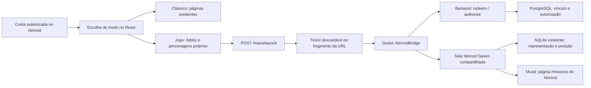

# Inn social do Nimrod — Sprints 1 e 2

Data: 15/10/2026. Escopo: escolha opcional de experiência e primeira cena social no jogo existente.

## Diagnóstico da base encontrada

O Nimrod usa React/Vite e React Router. `main.jsx` fornece autenticação e WebSocket; `App.jsx` mantém splash, consentimento, nome e páginas dentro de `Layout`. A rota `/` carregava diretamente `HomePage`, o mural clássico. `/lobby` já selecionava personagens vinculados e iniciava o Source of Mana.

O jogo existente está isolado em `experiments/source-of-mana`. O checkout upstream fixado e ignorado por Git é preparado por `prepare.ps1`, com patch local, scripts de integração e cena Tiled gerada por `build-lobby.mjs`. Os contêineres Godot e Nginx servem o multiplayer e a exportação web. Isso foi preservado; não foi criado outro motor, transporte ou serviço multiplayer.



O backend já resolve o usuário a partir da autenticação, valida propriedade e estado do personagem e emite tickets curtos de uso único. O servidor do jogo resgata o ticket com credencial própria e revalida a autorização periodicamente. Nomes e UUIDs vêm desse fluxo. Nenhuma identificação de jogador foi acrescentada ao cliente como fonte de autorização.

Há também um experimento de taverna anterior ligado ao WebSocket do backend. Esta entrega usa o Source of Mana já integrado. Não migra nem remove o experimento anterior, Foundry Bridge, Redis, módulos do Foundry ou páginas de side quests.

## Sprint 1 — entrada opcional

### Entregue

- Sem preferência salva, `/` mostra duas opções: Modo Clássico e Modo Jogo.
- Clássico renderiza a `HomePage` existente; Jogo leva a `/lobby`. Entrar efetivamente no multiplayer continua exigindo selecionar um personagem elegível.
- A preferência fica em `localStorage`, por UUID da conta. Valor inválido é ignorado; armazenamento indisponível mantém a escolha durante a sessão React.
- O menu permite alternar a qualquer momento, inclusive com nomes acessíveis quando os textos dos ícones ficam ocultos no celular.
- O retorno explícito `/?experience=classic` abre o mural clássico e salva essa escolha. A notificação de enquete usa esse retorno para continuar abrindo seu mural.
- `/lobby` explica as áreas sociais, mantém carregamento/erro/atualização e informa como vincular um personagem quando necessário. Missões, perfil, calendário e demais rotas permanecem acessíveis.

### Arquivos alterados ou criados

| Arquivo | Alteração nesta sprint |
|---|---|
| `frontend/src/contexts/ExperienceContext.jsx` | Novo contexto de preferência local por conta, sem banco/API novos. |
| `frontend/src/pages/ExperienceEntryPage.jsx` | Nova escolha inicial e retorno explícito ao modo clássico. |
| `frontend/src/styles/experience.css` | Cartões responsivos e apresentação da entrada da inn. |
| `frontend/src/main.jsx` | Composição do provider com os contextos existentes. |
| `frontend/src/App.jsx` | Entrada em `/` e destino explícito da notificação de enquete. |
| `frontend/src/components/Layout.jsx` | Alternância dos dois modos no menu existente. |
| `frontend/src/pages/LobbyPage.jsx` | Apresentação social e atalhos para mural/perfil/clássico; mantém lançamento autenticado. |
| `experiments/source-of-mana/verification/experience-entry.mjs` | Verificação de interface com identidades e respostas isoladas por interceptação de rede. |

### Fallbacks e limites

A preferência é local ao navegador/origem, não sincronizada entre dispositivos. Não foi acrescentado campo no perfil ou migração. Esse estado não concede acesso ao jogo. A ausência de personagens não inventa um personagem nem permite entrada anônima.

## Sprint 2 — primeira inn social

### Entregue

- A mesma sala persistente `Nimrod Tavern`, instância compartilhada, foi ampliada para 36 × 28 células de 32 px.
- Piso de madeira, tapetes, balcão com anfitriã, seis mesas com assentos, salão central, passagens laterais, entrada, recanto e mural visual. Foram reutilizados os tiles upstream e seus créditos. O pequeno mural é arte SVG própria, rasterizada no build porque o importador existente exige PNG/JPG.
- Cinco placas identificam áreas. O mapa, a colisão, os pontos de aproximação e os metadados usados pelo jogo saem do mesmo gerador. Uma Resource GDScript gerada preserva esses metadados na exportação web, que exclui mapas brutos.
- O painel prioriza presença, circulação, botão de chat local, mural e modo clássico. Pode ser recolhido e começa compacto em telas estreitas. As barras de combate, a barra de ações e as dicas antigas sobrepostas ficam ocultas enquanto o escopo é lobby; o fluxo de aventura continua separado.
- O chat e os nomes acima dos sprites continuam usando o transporte e a identidade autorizada existentes. A mesa de cartas já existente fica em seção opcional recolhida; nenhum novo minigame ou sistema de combate foi introduzido.
- O mural do cenário e seu atalho abrem `/missions`, a página real de aventuras/avisos do Nimrod. Não há uma segunda lista de missões fictícias, inscrição automática ou combate ao entrar na sala.
- Cliques do lobby respeitam a colisão da nova planta. Posições salvas válidas são mantidas; posições dentro de móveis, fora da sala ou sem espaço mínimo retornam à entrada. Os UUIDs e a representação SQLite existente são preservados.

### Arquivos alterados ou criados

| Arquivo | Alteração nesta sprint |
|---|---|
| `experiments/source-of-mana/build-lobby.mjs` | Planta ampliada, mobiliário, mural, colisão, áreas e Resource gerada. |
| `experiments/source-of-mana/integration/HubLayout.gd` | Novo adaptador de planta, células caminháveis e posição segura. |
| `experiments/source-of-mana/integration/NimrodBridge.gd` | Limites de clique/posição pela planta; navegação restrita de volta ao Nimrod. |
| `experiments/source-of-mana/integration/LobbySocial.gd` | Painel social, placas, interação do mural e apresentação opcional das cartas. |
| `experiments/source-of-mana/integration/BuildMinimap.gd` | Mantém minimapa da colisão e rasteriza o SVG original para o importador. |
| `experiments/source-of-mana/verification/hub-layout.mjs` | Conectividade, acesso às áreas, limites e referências de tilesets. |
| `experiments/source-of-mana/verification/HubLayoutTest.gd` e `.tscn` | Posições válidas, inválidas e recuperação segura no Godot. |
| `experiments/source-of-mana/verification/LobbyClient.gd` | Acrescenta verificação das placas, HUD social e circulação no recanto ampliado. |
| `experiments/source-of-mana/verification/hub-web.mjs` | Entrada real de fixture no web export e navegação do mural/clássico. |
| `experiments/source-of-mana/verification/lobby-integration.mjs` | Opção para executar também a verificação web no ambiente descartável existente. |

`prepare.ps1` continua copiando a integração e executando o gerador. `game/data/maps/nimrod/{tavern.tmx,floorplan.json}`, `game/data/graphics/tilesets/nimrod/{noticeboard.tsx,noticeboard.svg}` e `game/sources/integration/HubLayoutData.gd` são resultados regeneráveis no checkout ignorado. A arte fica fora dos mapas brutos para entrar no pacote web. PNG e minimapa são produzidos no build Docker. Não editar esses resultados manualmente.

### Integração real, fallback e persistência

| Item | Situação |
|---|---|
| Usuário, propriedade e estado do personagem | Fluxo real do Nimrod, sem mock em execução normal. |
| Identidade/nome do personagem, multiplayer, movimento e chat | Integração real existente, reaproveitada. |
| Aparência e atributos do avatar | Defaults do Source of Mana; ainda não traduzem o token, raça, classe ou ficha D&D do Foundry. |
| Mural de aventuras | Atalho para o `/missions` existente; leitura de cards dentro do canvas não faz parte desta entrega. |
| Retorno do jogo ao Nimrod | Apenas dica de origem HTTP(S), sem credencial; aceita mesmo hostname ou equivalentes de loopback. Outros hosts ou cliente nativo desabilitam os atalhos e usam a aba do Nimrod. |
| Posição e representação | SQLite/volume existente; sem migração ou reset. |
| Presença, chat e cartas | Estado transitório; não é histórico social durável. Reiniciar desconecta jogadores e encerra interações transitórias. |
| Preferência de modo | Por conta neste navegador, sem alteração de esquema. |

O parâmetro de origem não participa da autenticação. Destinos são limitados a `/missions` e `/?experience=classic`, com nova aba e `noopener,noreferrer`. Não são enviados cookie, sessão humana, email ou segredo de bridge. O ticket permanece no fragmento e é removido pelo cliente após sua leitura, como antes.

## Verificação

Os resultados abaixo distinguem execução de leitura de código. Os artefatos locais em `experiments/source-of-mana/artifacts/` são ignorados por Git; os relatórios não incluem dados pessoais, tickets ou credenciais.

| Verificação executada | Resultado |
|---|---|
| Build React/Vite e imagem frontend | Passou; permanece o aviso de bundle acima de 500 kB, sem trocar bibliotecas ou refatorar o carregamento. |
| `experience-entry.mjs`, Edge headless | Passou no Vite e novamente contra o frontend compilado em `localhost:8088`: ambos os modos, recarga, conta diferente, preferência inválida/armazenamento bloqueado, ausência/elegibilidade de personagens, falha/retry do lançamento, URL opaca e mural existente. Capturas desktop/mobile revisadas. |
| `hub-layout.mjs` | Passou: 675 células caminháveis conectadas, cinco áreas acessíveis, limites sólidos e tilesets existentes. |
| `HubLayoutTest.tscn`, Godot | Passou: restauração válida, fallback para móvel/fora do mapa e espaço ampliado. |
| Importação e exportação Godot/Docker | Passou na versão final, incluindo a Resource da planta e a arte do mural no pacote web. |
| `lobby-integration.mjs`, PostgreSQL e SQLite temporários | Passou na versão final: dois clientes reais, identidade/sprite, placas, barras de combate ocultas, movimento até a área ampliada, chat, cartas já existentes, NPC, desconexão, rename/reconexão, replay, expiração e propriedade. |
| `hub-web.mjs` no runner isolado, Edge headless | Passou na versão final: login com ticket real de fixture, cena exportada, botões do mural/clássico, clique no mural físico acompanhando a câmera, painel compacto/expansão no viewport mobile e abertura do mural, sem `window.opener` ou erro de script. Capturas revisadas. |
| `lobby-real-web.mjs`, serviços locais | Passou: personagem já vinculado entrou pela interface real, com remoção do fragmento; capturas da entrada desktop/mobile e cena. Sem alterar vínculo, ficha ou recursos D&D. |

As verificações de UI com fixtures interceptam a API apenas no navegador de teste. As verificações multiplayer usam as rotas/middleware reais com PostgreSQL/SQLite descartáveis e identidades sintéticas. Nenhuma verificação acessa produção. O teste web real usa apenas os serviços locais; não implica teste de iOS, Android físico, HTTPS público, carga elevada ou acessibilidade completa do canvas.

O importador/encerramento upstream ainda emite avisos de UID e liberação de recursos. Isso não é apresentado como resolvido. Compilação de scripts, entrada, interação e navegação têm verificações próprias.

Correções encontradas pela execução desta entrega: recortes de parede usados como piso; metadados e arte omitidos pelo filtro de exportação web; painel social visível abaixo da camada 128 da GUI original, sem receber cliques. O piso foi corrigido, metadados viraram Resource gerada e a arte usa o diretório de gráficos; controles sociais ficam acima da camada existente. Os cliques do mural/painel e a versão compacta foram exercitados depois dessas correções.

Evidências locais: `hub-build.log`, `hub-frontend-build.log`, `experience-entry.log`, `hub-spawn.log`, `hub-integration.log`, `hub-web-navigation.log`. Capturas com identidade sintética: `experience-desktop.png`, `experience-mobile.png`, `hub-fixture-web.png`, `hub-fixture-web-mobile.png`. Capturas do teste da conta real permanecem privadas no diretório ignorado e não são reproduzidas neste relatório.

## Operação local e próximos passos

Os serviços frontend, `mana-server` e `mana-web` são recompilados/recriados localmente com os overlays existentes. Banco, volume SQLite, Redis, Foundry Bridge e módulos do Foundry são preservados. Não há mudança de esquema, credencial, contrato de backend ou configuração de produção nesta entrega.

Para conferir, abra `http://localhost:8088/`, escolha Modo Jogo, selecione um personagem próprio e entre. Acesso direto a `http://localhost:5184/` continua sem conceder identidade: a entrada autenticada começa no Nimrod.

Validação reproduzível:

```powershell
./experiments/source-of-mana/prepare.ps1
node experiments/source-of-mana/verification/hub-layout.mjs
npm --prefix frontend run build
# Frontend de teste em terminal separado; as respostas são interceptadas pelo teste.
npm --prefix frontend run dev -- --host 127.0.0.1 --port 5190 --strictPort
node experiments/source-of-mana/verification/experience-entry.mjs
# Requer Docker, dependências backend e Playwright/Edge disponíveis.
$env:MANA_HUB_WEB_TEST = 'true'
node experiments/source-of-mana/verification/lobby-integration.mjs
```

O runner multiplayer usa portas locais de verificação 5185, 5186 e 55436 e para os serviços temporários em `finally`. `NODE_PATH` pode ser necessário quando Playwright estiver instalado no runtime de ferramentas, em vez do projeto. O verificador de UI aceita `NIMROD_FRONTEND_TEST_URL` para testar o frontend local compilado.

Próximo incremento recomendado: personalização visual do avatar em um adaptador dedicado e leitura do mural dentro do jogo, mantendo as rotas e a autorização atuais. Critérios futuros: mesmo UUID antes/depois da personalização, fallback para arte indisponível, lista de missões consistente com `/missions`, acesso por teclado/toque ao mural e nenhuma inscrição sem ação explícita. Persistência de preferências entre dispositivos e eventual histórico de chat devem ser decisões separadas, com necessidade e retenção definidas antes de migrar dados.
